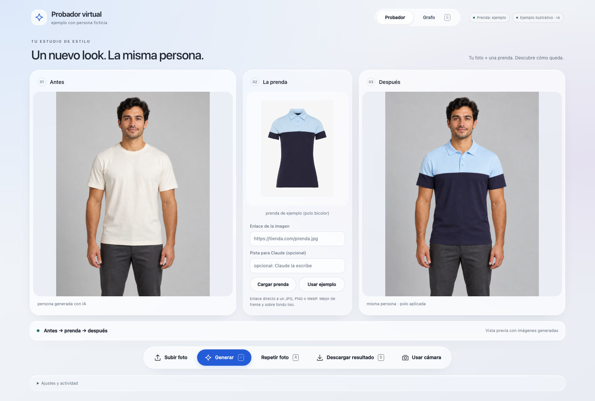
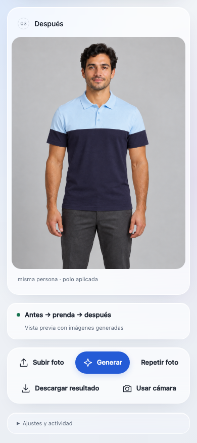
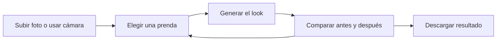
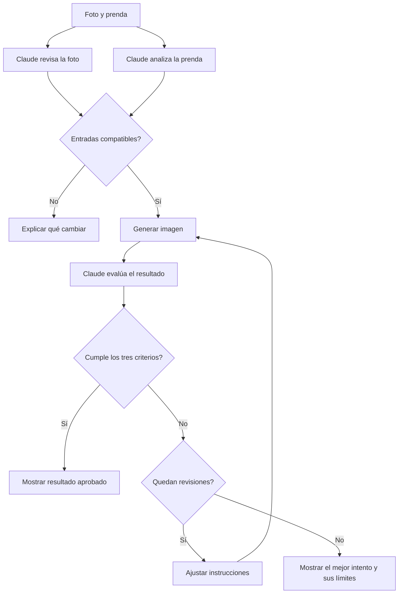
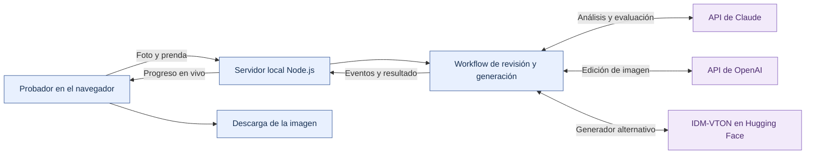

# Agentic Try-On

Un probador virtual que permite ver cómo queda una prenda sobre una persona antes de probársela.
Sube una foto, elige una prenda y compara el antes y el después en una misma vista.

**Disponible hoy:** probador web con subida de fotos o cámara, prendas por enlace, descarga del resultado
y un workflow con Claude que revisa las entradas, evalúa la imagen y puede pedir una corrección.
La pestaña **Grafo** permite seguir cada paso en vivo.

## El probador

### Escritorio

Foto original, prenda seleccionada y resultado juntos, con las acciones y el estado del proceso a la vista.



### Móvil

Los paneles se apilan para recorrer la foto, la prenda y el resultado. La descarga y las acciones siguen disponibles.



*Vistas del producto con un ejemplo ilustrativo.*

## Prueba un look

1. **Añade tu foto.** Usa **Subir foto** para elegir un JPG, PNG o WebP de hasta 12 MB, o pulsa **Usar cámara**.
   La cámara se activa únicamente cuando la eliges.
2. **Elige la prenda.** Empieza con la polo incluida o pega un enlace directo a una imagen de producto.
3. **Genera el resultado.** Pulsa **Generar** y sigue el progreso. En el modo agéntico puedes abrir **Grafo**
   para ver las revisiones y decisiones de Claude.
4. **Compara y descarga.** Revisa la imagen junto a la original, descarga el resultado o prueba otra foto.
   Puedes cancelar una generación en curso.



Para obtener mejores resultados, usa una foto de frente, con buena luz, cabeza y torso visibles y brazos sin cruzar.
La imagen de la prenda debe mostrar el producto de frente sobre fondo liso. Las fotos subidas se adaptan a 768×1024
conservando el encuadre completo.

## Elige cómo usarlo

| Modo | Qué ofrece | Cómo abrirlo |
| --- | --- | --- |
| **Agéntico** | Revisión de foto y prenda, generación, evaluación, correcciones y grafo en vivo | `npm start` → [localhost:3000](http://localhost:3000) |
| **Directo** | Generación con la prenda de ejemplo, sin servidor local | Abre [`index.html`](index.html) en Chrome |
| **Directo con prenda por enlace** | El mismo probador con selección de una prenda por URL | Abre [`custom-garment.html`](custom-garment.html) en Chrome |

Los modos directos llaman a IDM-VTON en Hugging Face y no necesitan instalar dependencias.
Su disponibilidad depende de la cola y la cuota del servicio. Los ajustes permiten configurar proveedores de respaldo.

### Iniciar el modo agéntico

Requiere Node.js 22 o superior y credenciales de Anthropic. Para generar con OpenAI, añade también su clave.
Desde la carpeta del repositorio:

```bash
npm install
cp -n .env.example .env
```

Configura en `.env`:

```dotenv
ANTHROPIC_API_KEY=tu_clave_de_anthropic
OPENAI_API_KEY=tu_clave_de_openai
```

```bash
npm start
```

Abre [localhost:3000](http://localhost:3000). Las claves se leen en el servidor local.
Para usar IDM-VTON como generador, configura `GENERATOR=idm`; Claude sigue realizando la revisión y la evaluación.
Consulta la [configuración completa](docs/DEVELOPMENT.md#configuración).

## Cómo decide el workflow

Claude analiza la foto y la prenda en paralelo. El flujo comprueba que la persona sea visible y que la prenda
sea compatible con el generador antes de solicitar una imagen. OpenAI o IDM-VTON generan el look; Claude lo evalúa.



La evaluación puntúa de 1 a 5 la **fidelidad de la prenda**, la **identidad de la persona** y el **realismo**.
Los tres criterios deben alcanzar 4 para aprobar. Por defecto se permite una revisión; si ningún intento aprueba,
el producto entrega el mejor disponible e indica los criterios incumplidos.

En **Grafo** puedes inspeccionar el nodo activo, las conexiones recorridas, los intentos y las salidas de cada paso.
El workflow está definido en código y tiene un límite de revisiones configurable.

## Arquitectura



Azul: interfaz y ejecución local. Violeta: servicios externos. El modo agéntico usa un generador por ejecución.
En los modos directos, el navegador se comunica con el proveedor de imagen sin pasar por el servidor local.

## Alcance actual

- **Prendas:** IDM-VTON trabaja con prendas de torso. La integración con OpenAI también admite pantalones y vestidos;
  la foto debe mostrar la parte del cuerpo correspondiente.
- **Resultado:** es una visualización generada, no una medición de talla ni una garantía de ajuste físico.
- **Datos:** las imágenes se envían a los proveedores que intervienen en la generación y, en el modo agéntico,
  en la evaluación. Los enlaces de prendas pueden pasar por un proxy público de imágenes.
- **Acceso:** el servidor está pensado para uso local. La interfaz se adapta a pantallas pequeñas;
  `npm start` escucha en `127.0.0.1`, por lo que no publica una aplicación accesible desde otro dispositivo.

## Explora el proyecto

| Recurso | Contenido |
| --- | --- |
| [Guía de desarrollo](docs/DEVELOPMENT.md) | Configuración, generación de los HTML, pruebas y diagnóstico |
| [Interfaz](src/template.html) | Plantilla compartida de las tres variantes del probador |
| [Workflow](agent/workflow.mjs) | Análisis en paralelo, evaluación y ciclo de revisiones |
| [Servidor](server.mjs) | API local y eventos de progreso |
| [Generador OpenAI](agent/openai.mjs) · [Generador IDM-VTON](agent/idm.mjs) | Integraciones de generación de imágenes |
