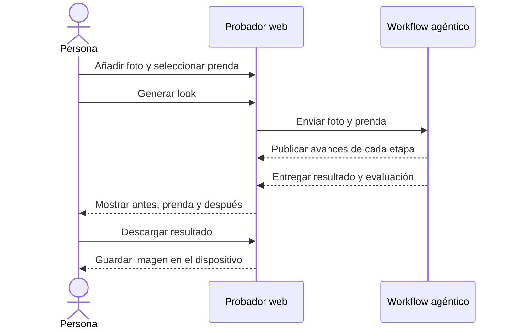
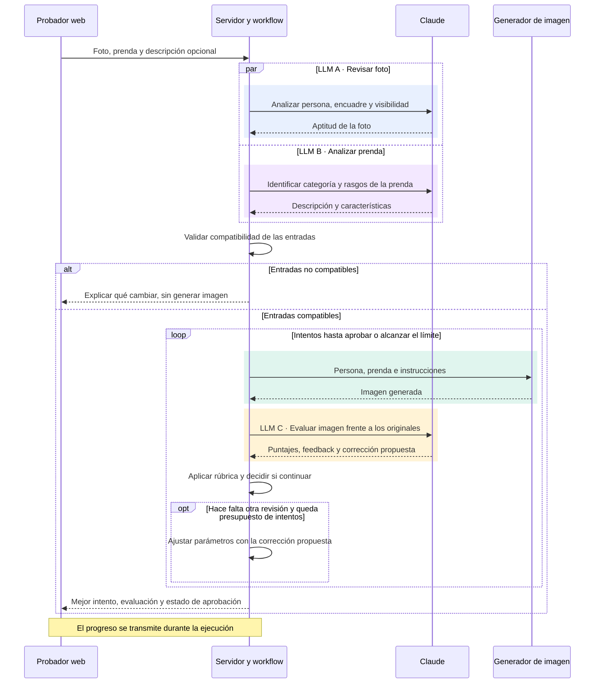
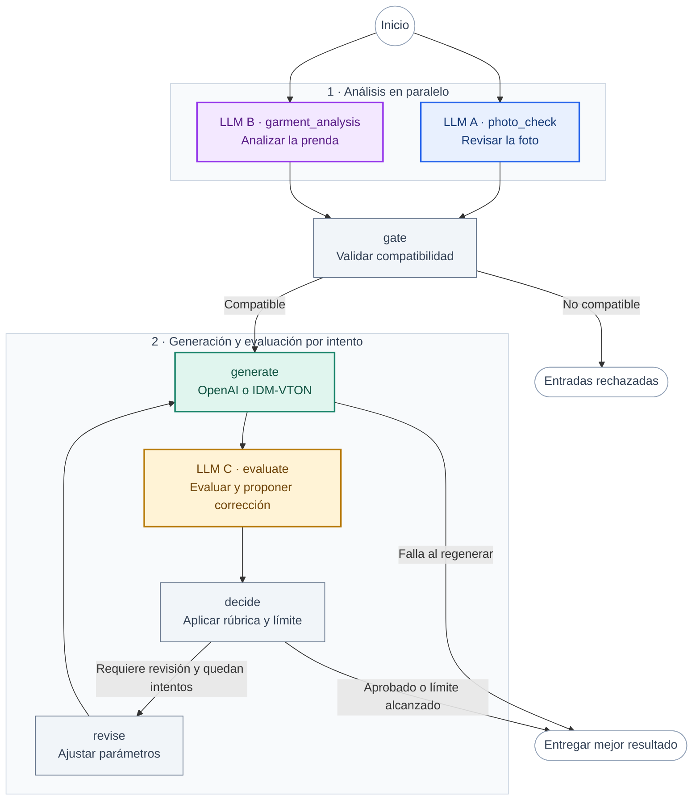

# Agentic Try-On

Un probador virtual que permite ver cómo queda una prenda sobre una persona antes de probársela.
Sube una foto, elige una prenda y compara el antes y el después en una misma vista.

**Disponible hoy:** probador web con subida de fotos o cámara, prendas por enlace, descarga del resultado
y un workflow con Claude que revisa las entradas, evalúa la imagen y puede pedir una corrección.
La pestaña **Grafo** permite seguir cada paso en vivo.

## El probador

En escritorio, compara la foto original, la prenda y el resultado en una misma vista. En móvil, recorre los paneles
apilados y accede a las mismas acciones.

<table>
  <thead>
    <tr><th>Escritorio</th><th>Móvil</th></tr>
  </thead>
  <tbody>
    <tr>
      <td width="77%" valign="top">
        
      </td>
      <td width="23%" valign="top">
        
      </td>
    </tr>
  </tbody>
</table>

*Vistas del producto con un ejemplo ilustrativo.*

## Prueba un look

1. **Añade tu foto.** Usa **Subir foto** para elegir un JPG, PNG o WebP de hasta 12 MB, o pulsa **Usar cámara**.
   La cámara se activa únicamente cuando la eliges.
2. **Elige la prenda.** Empieza con la polo incluida o pega un enlace directo a una imagen de producto.
3. **Genera el resultado.** Pulsa **Generar** y sigue el progreso. En el modo agéntico puedes abrir **Grafo**
   para ver las revisiones y decisiones de Claude.
4. **Compara y descarga.** Revisa la imagen junto a la original, descarga el resultado o prueba otra foto.
   Puedes cancelar una generación en curso.



Para obtener mejores resultados, usa una foto de frente, con buena luz, cabeza y torso visibles y brazos sin cruzar.
La imagen de la prenda debe mostrar el producto de frente sobre fondo liso. Las fotos subidas se adaptan a 768×1024
conservando el encuadre completo.

## Elige cómo usarlo

| Modo | Qué ofrece | Cómo abrirlo |
| --- | --- | --- |
| **Agéntico** | Revisión de foto y prenda, generación, evaluación, correcciones y grafo en vivo | `npm start` → [localhost:3000](http://localhost:3000) |
| **Directo** | Generación con la prenda de ejemplo, sin servidor local | Abre [`index.html`](index.html) en Chrome |
| **Directo con prenda por enlace** | El mismo probador con selección de una prenda por URL | Abre [`custom-garment.html`](custom-garment.html) en Chrome |

Los modos directos llaman a IDM-VTON en Hugging Face y no necesitan instalar dependencias.
Su disponibilidad depende de la cola y la cuota del servicio. Los ajustes permiten configurar proveedores de respaldo.

### Iniciar el modo agéntico

Requiere Node.js 22 o superior y credenciales de Anthropic. Para generar con OpenAI, añade también su clave.
Desde la carpeta del repositorio:

```bash
npm install
cp -n .env.example .env
```

Configura en `.env`:

```dotenv
ANTHROPIC_API_KEY=tu_clave_de_anthropic
OPENAI_API_KEY=tu_clave_de_openai
```

```bash
npm start
```

Abre [localhost:3000](http://localhost:3000). Las claves se leen en el servidor local.
Para usar IDM-VTON como generador, configura `GENERATOR=idm`; Claude sigue realizando la revisión y la evaluación.
Consulta la [configuración completa](docs/DEVELOPMENT.md#configuración).

## Proceso de generación

El modo agéntico coordina tres responsabilidades: **analizar las entradas**, **generar el look** y
**evaluar el resultado**. Los dos análisis iniciales se ejecutan en paralelo. El servidor valida la compatibilidad
antes de pedir una imagen y controla cuántas revisiones se permiten.



La evaluación puntúa de 1 a 5 la **fidelidad de la prenda**, la **identidad de la persona** y el **realismo**.
Los tres criterios deben alcanzar 4 para aprobar. Por defecto se permite una revisión; si ningún intento aprueba,
el producto entrega el mejor disponible e indica los criterios incumplidos.

El generador es **OpenAI o IDM-VTON**, según la configuración: se usa uno por ejecución.
En los modos directos, el navegador llama al proveedor de imagen sin este proceso de análisis y evaluación.

## Estructura del grafo

Esta es la estructura declarada en [`GRAPH`](agent/workflow.mjs), la misma que muestra la pestaña **Grafo**.
Cada nodo representa una operación. Los colores distinguen las tres llamadas a Claude, la generación de imagen
y las operaciones que ejecuta el código.



| Color y operación | Entrada → salida | Cuándo se ejecuta |
| --- | --- | --- |
| **Azul · LLM A** `photo_check` | Foto → aptitud, encuadre y partes visibles | Una vez, en paralelo con LLM B |
| **Violeta · LLM B** `garment_analysis` | Prenda → categoría, descripción y rasgos | Una vez, en paralelo con LLM A |
| **Ámbar · LLM C** `evaluate` | Foto, prenda e imagen generada → puntajes y corrección propuesta | Una vez por imagen generada |
| **Verde · Generador** `generate` | Persona, prenda y parámetros → nueva imagen | Una vez por intento |
| **Gris · Código** `gate`, `decide`, `revise` | Validaciones, rúbrica y parámetros → siguiente operación | Sin llamadas adicionales a Claude |

A, B y C son funciones del **mismo modelo de Claude**, no tres modelos distintos. El color identifica la función:
si hay una revisión, se repiten el generador verde y la evaluación ámbar. La corrección la propone `evaluate`;
`revise` solo la aplica en código.

| Resultado del proceso | Llamadas lógicas a Claude | Imágenes generadas |
| --- | --- | --- |
| Entradas rechazadas por la validación | 2: A + B | 0 |
| Resultado aprobado en el primer intento | 3: A + B + C | 1 |
| Se completa una revisión adicional | 4: A + B + C + C | 2 |

Si falla la generación de una revisión, se conserva el mejor intento anterior. Un fallo al generar la primera
imagen se presenta como error, porque todavía no existe un resultado que entregar.

En la pestaña **Grafo** puedes inspeccionar nodos, conexiones recorridas, repeticiones y salidas de cada paso.
La leyenda de esta documentación distingue las llamadas por función; en el visor interactivo, los colores base
agrupan por tipo de operación y el estado de ejecución se resalta en vivo.

## Alcance actual

- **Prendas:** IDM-VTON trabaja con prendas de torso. La integración con OpenAI también admite pantalones y vestidos;
  la foto debe mostrar la parte del cuerpo correspondiente.
- **Resultado:** es una visualización generada, no una medición de talla ni una garantía de ajuste físico.
- **Datos:** las imágenes se envían a los proveedores que intervienen en la generación y, en el modo agéntico,
  en la evaluación. Los enlaces de prendas pueden pasar por un proxy público de imágenes.
- **Acceso:** el servidor está pensado para uso local. La interfaz se adapta a pantallas pequeñas;
  `npm start` escucha en `127.0.0.1`, por lo que no publica una aplicación accesible desde otro dispositivo.

## Explora el proyecto

| Recurso | Contenido |
| --- | --- |
| [Guía de desarrollo](docs/DEVELOPMENT.md) | Configuración, generación de los HTML, pruebas y diagnóstico |
| [Interfaz](src/template.html) | Plantilla compartida de las tres variantes del probador |
| [Workflow](agent/workflow.mjs) | Análisis en paralelo, evaluación y ciclo de revisiones |
| [Servidor](server.mjs) | API local y eventos de progreso |
| [Generador OpenAI](agent/openai.mjs) · [Generador IDM-VTON](agent/idm.mjs) | Integraciones de generación de imágenes |
